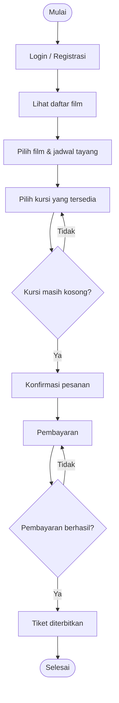
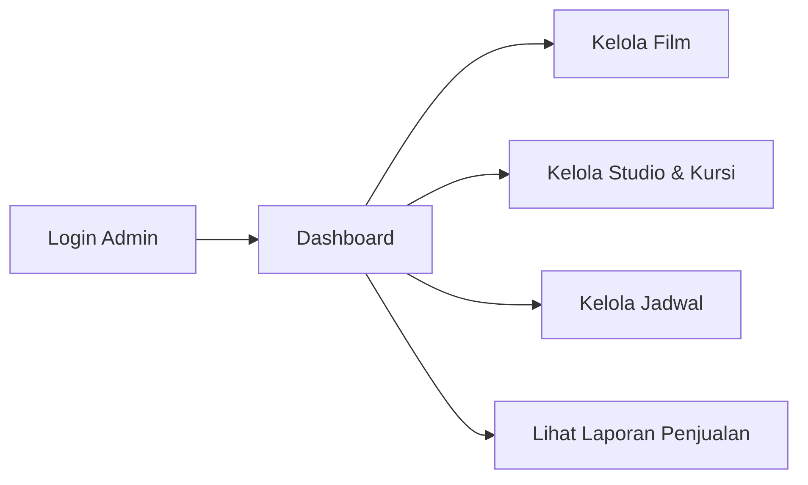
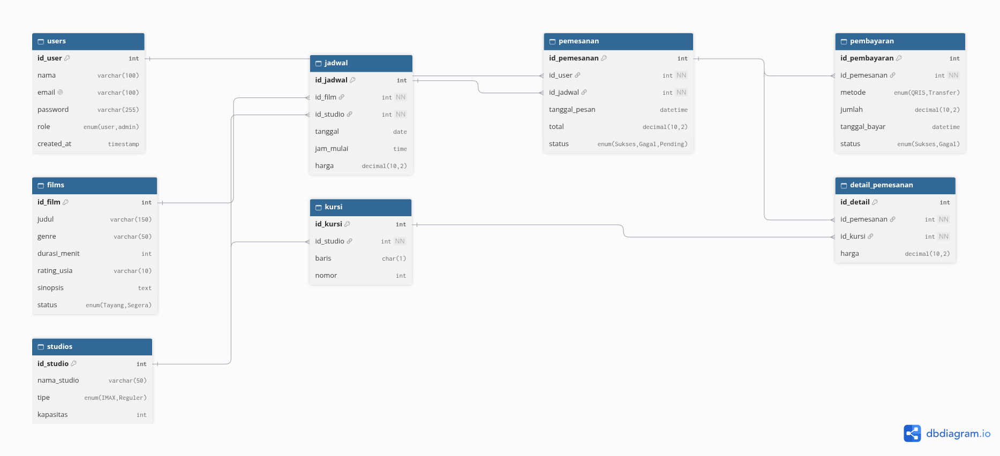
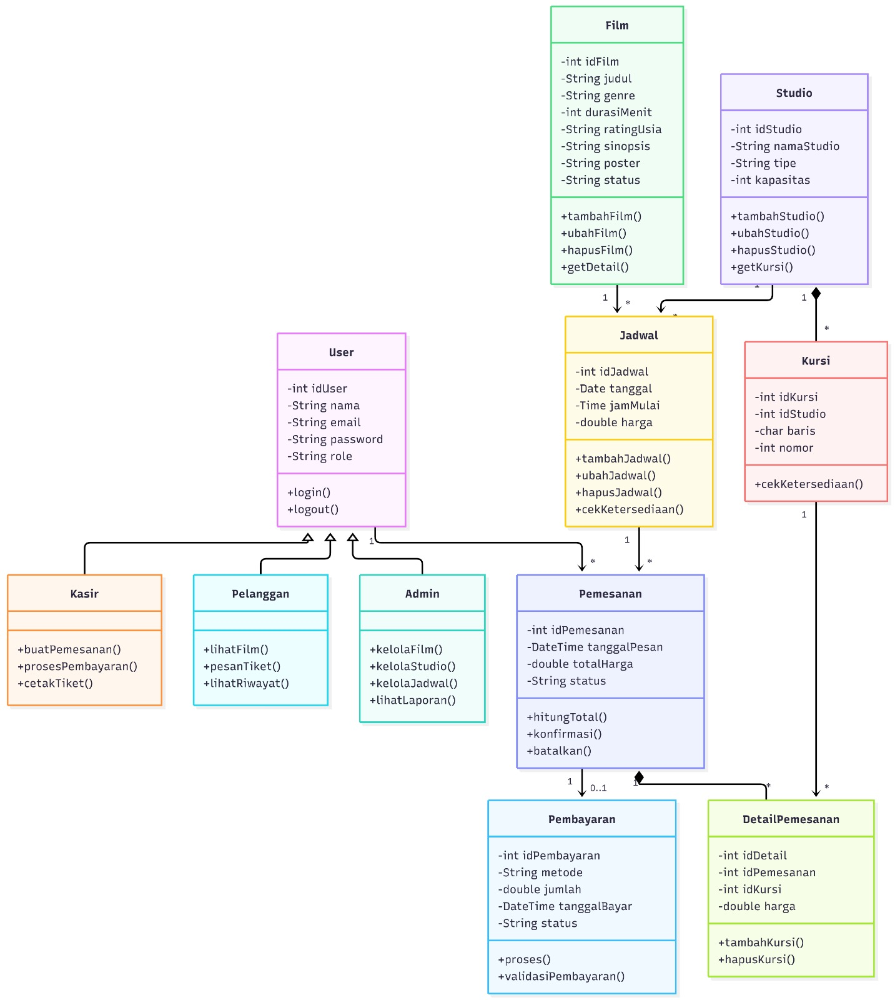

# 🎬 Sistem Manajemen Bioskop — PT.shs

aplikasi untuk mengelola operasional bioskop: film, jadwal tayang, studio, kursi, pemesanan tiket, dan pembayaran.

## Anggota Kelompok

1. Subhil Mubarak | 140810250032 
2. Sri Sukmawati | 140810250059 
3. Haifa Julda Almira | 140810250071 

---

## 1. Deskripsi Proyek

**Latar Belakang**:
Pengelolaan bioskop secara manual (jadwal di papan, tiket kertas, pencatatan penjualan di buku) rentan kesalahan, seperti: kursi terjual ganda, laporan pendapatan lambat, dan informasi film tidak mudah diakses pelanggan.

**Sistem Manajemen Bioskop PT.shs** adalah aplikasi yang memusatkan seluruh proses tersebut: admin mengelola film, studio, dan jadwal; kasir/pelanggan memesan tiket dengan memilih kursi secara langsung; dan manajemen dapat melihat laporan penjualan.

### Tujuan
- Mempermudah pengelolaan data film, studio, dan jadwal tayang.
- Mencegah pemesanan kursi ganda pada jadwal yang sama.
- Mempercepat proses pemesanan tiket dan pembayaran.
- Menyediakan laporan penjualan yang akurat.

---

## 2. Fungsionalitas

### Peran
**Admin** : Mengelola seluruh data master dan melihat laporan 

**Kasir** : Melayani pemesanan tiket langsung di loket 

**Pelanggan** : Melihat film, memesan tiket, melihat riwayat pesanan 

### Tabel Fungsionalitas
| Modul | Fitur | Deskripsi | Peran |
|-------|-------|-----------|-------|
| Autentikasi | Registrasi | Mendaftar akun dengan nama, email, dan password. | Pelanggan |
| Autentikasi | Login | Masuk dengan email dan password. Sesi aktif selama pengguna belum logout. | Semua |
| Autentikasi | Logout | Mengakhiri sesi aktif. | Semua |
| Film | Lihat film | Menampilkan film berstatus `tayang` atau `segera` beserta sinopsis, durasi, dan rating usia. Dapat difilter per genre. | Semua |
| Film | Kelola film | Menambah, mengubah, dan menghapus data film. Film yang sudah punya jadwal tidak dapat dihapus. | Admin |
| Studio | Kelola studio dan kursi | Mengatur studio, tipe (regular/premium), kapasitas, dan tata letak kursi. | Admin |
| Jadwal | Lihat jadwal | Menampilkan jadwal tayang per film dan tanggal beserta harga tiket. | Semua |
| Jadwal | Kelola jadwal | Menentukan film, studio, tanggal, jam, dan harga. Sistem menolak jadwal yang bentrok di studio yang sama. | Admin |
| Pemesanan | Pilih kursi | Menampilkan denah kursi. Kursi yang sudah dipesan pada jadwal tersebut tidak dapat dipilih. | Pelanggan, Kasir |
| Pemesanan | Buat pesanan | Mengonfirmasi kursi yang dipilih. Sistem mengecek ketersediaan kursi sebelum pesanan disimpan dengan status `pending`. | Pelanggan, Kasir |
| Pemesanan | Batalkan pesanan | Membatalkan pesanan selama statusnya masih `pending`, lalu kursi dilepas kembali. | Pelanggan, Kasir |
| Pembayaran | Bayar pesanan | Mencatat metode dan jumlah pembayaran. Jika berhasil, status pesanan menjadi `lunas`. | Pelanggan, Kasir |
| Pembayaran | Cetak tiket | Menampilkan atau mencetak tiket untuk pesanan yang sudah `lunas`. | Pelanggan, Kasir |
| Riwayat | Lihat riwayat | Menampilkan daftar pesanan milik pengguna sendiri. | Pelanggan |
| Laporan | Rekap penjualan | Menampilkan pendapatan harian atau bulanan dan film terlaris. | Admin |

---

## 3. Alur Aplikasi

### Alur Pemesanan Tiket


### Alur Admin


---

## 4. Rancangan Database

### Struktur Tabel


---

## 5. Rancangan Class



    class User {
        -int idUser
        -String nama
        -String email
        -String password
        -String role
        +login()
        +logout()
    }
    class Admin {
        +kelolaFilm()
        +kelolaStudio()
        +kelolaJadwal()
        +lihatLaporan()
    }
    class Kasir {
        +buatPemesanan()
        +cetakTiket()
    }
    class Pelanggan {
        +lihatFilm()
        +pesanTiket()
        +lihatRiwayat()
    }
    class Film {
        -int idFilm
        -String judul
        -String genre
        -int durasi
        -String ratingUsia
        +getDetail()
    }
    class Studio {
        -int idStudio
        -String namaStudio
        -String tipe
        -int kapasitas
        +getKursiTersedia(jadwal)
    }
    class Kursi {
        -int idKursi
        -char baris
        -int nomor
    }
    class Jadwal {
        -int idJadwal
        -Date tanggal
        -Time jamMulai
        -double harga
        +cekKetersediaan()
    }
    class Pemesanan {
        -int idPemesanan
        -DateTime tanggalPesan
        -double totalHarga
        -String status
        +hitungTotal()
        +batalkan()
    }
    class Pembayaran {
        -int idPembayaran
        -String metode
        -double jumlah
        -String status
        +proses()
    }


---

## 6. Teknologi

Bahasa / Framework : Java 

GUI : Java Swing

Database : MySQL 

IDE : NetBeans

Version Control : Git & GitHub 

## 7. Struktur Folder (Rencana)
```
manajemen-bioskop/
├── docs/            # dokumentasi & diagram
├── database/        # skema SQL & seeder
├── src/             # kode sumber
└── README.md
```

---

2026 **PT.shs** — Kelompok shs